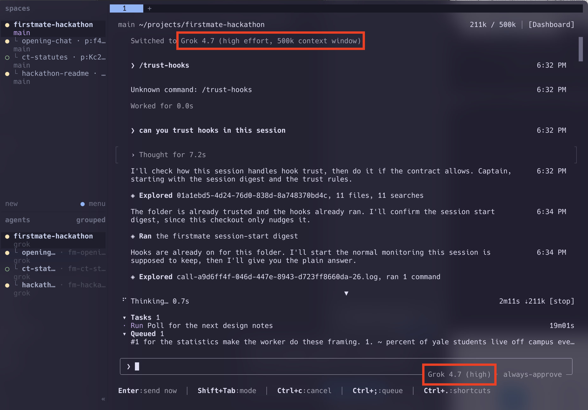

<p align="center">
  
</p>

<h1 align="center">Eli</h1>

<p align="center">
  An AI agent that helps an off-campus renter turn a housing problem into the right letter.
</p>

<p align="center">
  
  
</p>

---

## Demo

[Watch the 20 second demo](demo/eli-demo.mp4)

<video src="demo/eli-demo.mp4" width="960" controls></video>

## Overview

At Yale, 86 percent of graduate and professional students live off campus. In the same September 2023 [Yale Daily News](https://yaledailynews.com/articles/affordable-housing-crisis-leaves-grad-students-and-city-residents-scrambling) article, 83 percent found their place through someone other than Yale.

When a stove that came with the apartment stops working, the lease may say the repair is the tenant's, and Connecticut law may still put it on the landlord. Both documents are hard to read, so a lot of people send a short text, or they do nothing.

Eli knows the address and the lease. It quotes the clause and the statute, says whose job the repair is, and writes the letter. The student sends that letter from their own mail app. After the letter comes a complaint to the city, and after that the 21 day option to pay rent to the court.

The apartment in this demo is fictional: Apartment 4 at 18 Quill Street, owned by Quill Harbor LLC.

## Quick start

From the project folder:

```bash
export XAI_API_KEY=your-key
npm start
```

The app is at `http://localhost:4173`. The key stays in the environment. It is not committed.

```bash
npm test
```

## Features

- **The lease, then the letter.** The student sends the lease in the chat. Eli reads it and drafts the request.
- **Quoted sources.** The answer cites the lease clause and the stored Connecticut statute text.
- **Sent from the student's mail.** The letter opens in their own mail app.
- **What comes next.** The letter, a city complaint, then the 21 day court option.
- **A name, and that is the sign-in.** No school account.

## Tech stack

Node · a small local server · the xAI Grok API · JetBrains Mono

## Status

Hackathon build. The place in the story is fictional.

## Grok

This ran on Grok 4.7, high effort, with a 500k context window.


